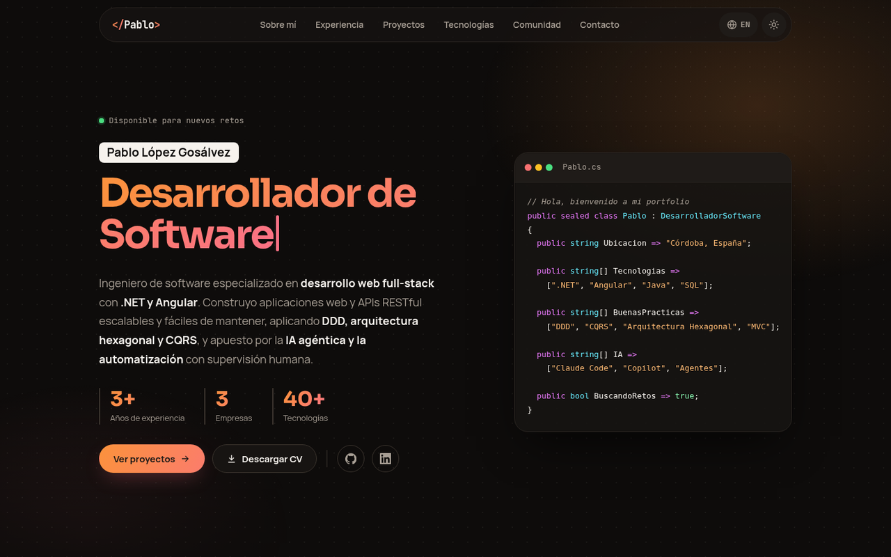

# Portfolio · Pablo López Gosálvez

Portfolio personal de **Pablo López Gosálvez**, desarrollador de software full-stack (.NET · Angular) especializado en IA agéntica y automatización.

Es un sitio estático hecho con [Astro](https://astro.build), bilingüe (español e inglés), con modo claro y oscuro y scroll suavizado.



## Características

- **Bilingüe:** el español está en `/` y el inglés en `/en/`. Todos los textos salen de un único archivo de traducciones.
- **Modo claro y oscuro:** la primera vez sigue la preferencia del sistema operativo y después recuerda la elección del usuario, sin parpadeo al cargar.
- **Scroll suavizado** con [Lenis](https://github.com/darkroomengineering/lenis), incluidos los enlaces del menú.
- **Animaciones:** el rol del inicio se escribe a máquina y los bloques aparecen al hacer scroll. Además hay una barra de progreso de lectura y las tarjetas tienen un brillo que sigue al ratón.
- **Accesible:** enlace para saltar al contenido, navegación con teclado y textos para lectores de pantalla. Si el usuario tiene activado "reducir movimiento", se desactivan las animaciones.
- **Diseño adaptable** a móvil, con menú desplegable.
- **Imágenes optimizadas** con `astro:assets`, que las convierte a WebP en varios tamaños.

### Secciones

Inicio · Sobre mí · Experiencia y formación · Proyectos · Tecnologías · Comunidad · Contacto

## Stack

| | |
| :-- | :-- |
| Framework | Astro 7 |
| Lenguajes | TypeScript, CSS (sin frameworks de estilos) |
| Scroll suavizado | Lenis |
| Tipografías | Sora, Manrope y JetBrains Mono (vía Fontsource, alojadas en el propio sitio) |
| Desarrollo | Con Claude Code como agente de programación |

## Puesta en marcha

Necesitas **Node.js 22.22 o superior**.

```sh
npm install
npm run dev
```

El sitio arranca en `http://localhost:4321`.

| Comando | Acción |
| :-- | :-- |
| `npm install` | Instala las dependencias |
| `npm run dev` | Arranca el servidor de desarrollo en `localhost:4321` |
| `npm run build` | Genera el sitio de producción en `./dist/` |
| `npm run preview` | Sirve la build en local para revisarla antes de desplegar |

## Estructura

```text
/
├── public/
│   └── cv/                    # CV descargable en PDF (es / en)
├── src/
│   ├── assets/                # Foto de perfil y portadas de proyectos
│   ├── components/            # Una sección por componente (Hero, About, Projects…)
│   ├── i18n/ui.ts             # Todos los textos, datos de proyectos y enlaces
│   ├── layouts/Layout.astro   # <head>, tema, Lenis y animaciones de aparición
│   ├── pages/
│   │   ├── index.astro        # Versión en español
│   │   └── en/index.astro     # Versión en inglés
│   └── styles/global.css      # Colores y tipografías de ambos temas, y estilos comunes
└── astro.config.mjs
```

## Despliegue

`npm run build` genera un sitio estático en `dist/`. Se puede publicar en cualquier hosting estático, como Vercel, Netlify o GitHub Pages, sin configuración adicional.